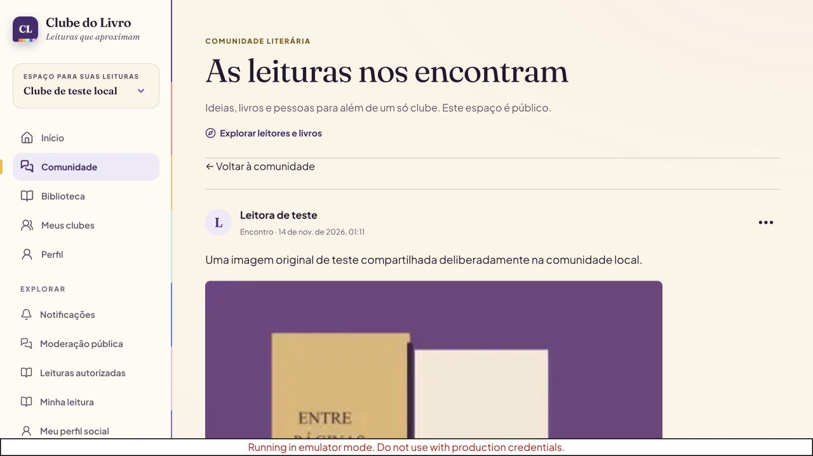
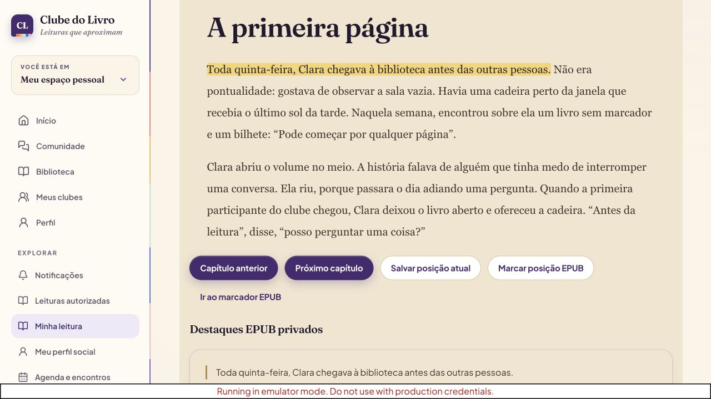

# Liberação da plataforma social — revisão para autorização

Estado: implementação e ensaios locais validados, ainda não autorizada para produção. Código na branch `codex/plataforma-social`, [PR #2](https://github.com/layonlad/Aplica-o-Clube-do-Livro/pull/2). Usar o hash exibido no cabeçalho do PR e conferir o CI desse mesmo hash antes da liberação.

## Escopo público da liberação

Publicar os três ambientes conectados: comunidade pública, comunidades privadas dos clubes e biblioteca/leitor pessoal. Entrada como visitante continua disponível. Conteúdo de clube exige associação ativa; publicar na comunidade exige conta confirmada e perfil público. Não ativar planos pagos, faturamento Google Cloud ou serviços além dos já escolhidos.

Infraestrutura existente:

| Serviço | Alvo |
| --- | --- |
| Firebase Hosting/Auth | `project-acb850f4-4bb8-45de-a84` |
| Frontend | `https://project-acb850f4-4bb8-45de-a84.web.app` |
| Render Free | `clube-livro-api`, serviço `srv-dbrjddl9fdbs73eikb0g` |
| API | `https://clube-livro-api.onrender.com` |
| Neon Free | projeto `wandering-block-99253816`, banco `clube_do_livro`, branch `br-super-term-bco4myiu` |
| Object Storage | bucket privado `clube-livro-media`, credencial com acesso somente a Storage no projeto/branch |
| Moderação pública | conta escolhida: `negocio.layon@gmail.com`; UID verificado, somente no segredo do servidor |

## Operações que dependem da aprovação

1. Criar uma cópia privada de recuperação do banco no mesmo projeto Neon, dentro da franquia gratuita. Nenhum dump de registros reais será colocado no Git ou usado em testes locais. Manter a cópia para recuperação até uma decisão posterior; sua exclusão não é autorizada implicitamente por esta liberação.
2. Revalidar o estado atual e aplicar **003–015** em uma transação com lock de migração, conferindo os checksums de 001/002. A cópia da estrutura de produção já foi ensaiada apenas localmente, sem linhas de usuários. A versão anterior continua compatível durante a troca da API.
3. Aplicar `server/ops/runtime-grants.sql` com um papel proprietário habilitado a conceder permissões. A API continua usando `clube_runtime`, nunca a identidade de migração. Não conceder CREATE, leitura de migrations ou modificação da auditoria.
4. Instalar no segredo da API a configuração do bucket privado e o UID da moderação escolhida. Credenciais ficam somente no servidor, fora de variáveis `VITE_*`. Não publicar o bucket nem criar chaves de service account Firebase.
5. Habilitar a rotina de manutenção revisada (`MEDIA_CLEANUP_ENABLED=true`): lotes de notificações com mais de 90 dias e arquivos já revogados/abandonados, com período de segurança para falhas e revisão de escrita tardia. Não descartar o JSON legado durante esta liberação.
6. Incorporar o PR validado e publicar a API no Render, aguardar disponibilidade, testar rotas/ACLs e só então publicar o frontend no Firebase Hosting. O modo conectado exige projeto correto e API saudável no script de build.
7. Fazer um teste final com registros sintéticos, sem e-mails externos ou alteração de contas existentes. Se for necessária uma nova conta descartável no Firebase, sua criação e exclusão precisam constar da autorização de liberação; não presumir autorização para excluir qualquer conta real. Remover somente os registros/arquivos criados por esse teste, conforme autorizado.

Não há solicitação de contratar upgrade, novo servidor pago, Cloud SQL, Cloud Functions ou Firebase App Hosting.

## Validação antes da liberação

- 111 testes locais aprovados (32 frontend, 28 API, 50 PostgreSQL e 1 Auth Emulator). O CI de 24c36c0 passou com builds e Docker; conferir novamente o CI do hash final do PR. O build com configuração real de produção também passou, sem deploy.
- Auditoria npm de dependências de produção: zero vulnerabilidades na consulta final local. O CI aplica o limiar de severidade alta a todas as dependências; avisos moderados de ferramentas de desenvolvimento devem ser registrados sem forçar uma atualização incompatível.
- Ensaiar migrations 003–015 duas vezes sobre a estrutura restaurada localmente a partir de produção. Conferir preservação dos fixtures e idempotência; não copiar dados de usuários.
- Consulta somente de leitura ao legado de produção em 14/11/2026 não encontrou tópicos ou eventos para reconciliar. Conferir novamente imediatamente antes de migrar; qualquer autoria/associação inválida deve interromper o processo, preservando a fonte.
- Conferir que o papel restrito executa os fluxos da API e não consegue DDL, leitura de `schema_migrations`, DELETE em usuários ou alteração de auditoria.
- Testes de foto/vídeo/EPUB usam bytes sintéticos e armazenamento local/mock. A integração real com o bucket será confirmada durante a liberação aprovada, com objeto descartável privado e limpeza autorizada.

## Ordem e recuperação

API primeiro, frontend depois. HTML e respostas privadas usam `no-store`; assets com hash são cacheáveis. Preservar o artefato/versão anterior do frontend e a imagem anterior da API para diagnóstico, mas não fazer downgrade cego do banco.

As migrations mantêm as tabelas e os snapshots de origem. Se a nova interface falhar, reverter somente a interface e manter a API compatível enquanto se corrige o problema. Se houver falha de dados, interromper novas gravações e avaliar a cópia de recuperação antes de restaurar; restaurar uma cópia por cima de dados atuais é uma ação distinta que precisa de autorização.

Estados novos de leitura/perfil não existem no código antigo. Reverter a API para um binário anterior às novas estruturas pode fazer a validação antiga rejeitar estados novos. Preferir correção para frente ou uma imagem de compatibilidade testada; não executar down migration nem apagar as novas tabelas para “voltar”.

## Limites comunicados

O plano gratuito tem franquias e o Render pode suspender a API por inatividade. EPUBs originais e mídias não integram o backup JSON. O leitor seguro não executa DRM, CSS de editoras, scripts ou recursos externos. Relatórios de qualidade não representam certificação jurídica de direitos autorais ou LGPD. A exclusão integral automatizada da identidade Firebase não foi implementada; os controles de exclusão de conteúdo, arquivos, notas e privacidade estão disponíveis. Detalhes em `ENTREGA_PLATAFORMA_06.md`.

## Evidências de interface

Todas usam conteúdo e contas sintéticos no ambiente local.

Conferência móvel: [comunidade](evidence/community-mobile.jpg) e [leitor](evidence/epub-mobile.jpg), ambos com documento de 390px para viewport de 390px.
