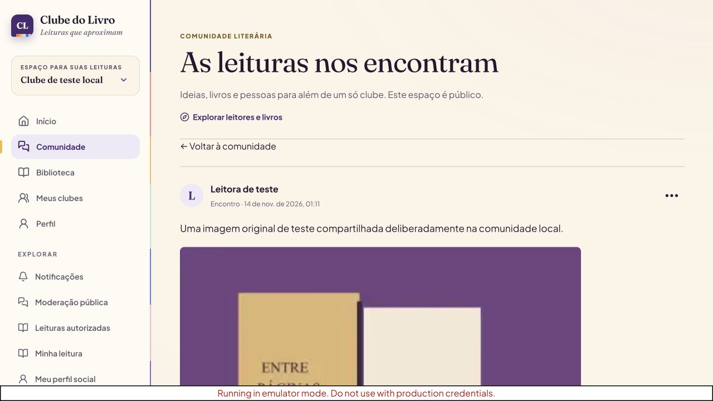
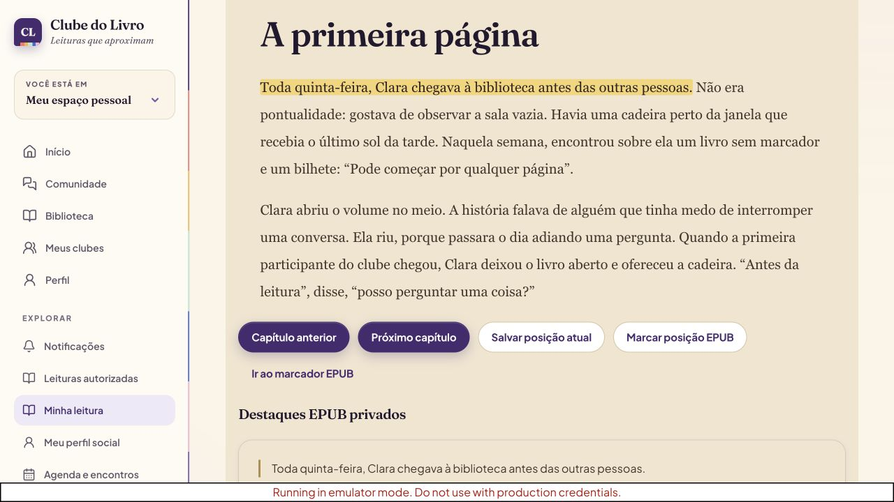

# Liberação da plataforma social — plano e registro

> **Atualização de 16/11/2026:** PR 27 publicado no merge `aaef7fa`, com API/executor no Cloud Run, PostgreSQL no Cloud SQL e os dois sites Firebase. Backup privado, migration 019 e grants mínimos aplicados; validação sintética concluída e identidades de teste removidas. [Registro atual da publicação](publicacoes/2026-11-16-pr27.md). Os trechos de Render/Neon e pendências de grants abaixo são o registro histórico de 14/11.

Registro histórico: a liberação foi autorizada e executada em 14/11/2026. O [PR #2](https://github.com/layonlad/Aplica-o-Clube-do-Livro/pull/2) foi incorporado, incluindo os PRs #5–#7. API no Render e frontend no Firebase Hosting usam o código de `b64835d`; o CI desse commit passou. O plano abaixo registra a revisão anterior à publicação e serve de checklist para futuras liberações.

A cópia privada de recuperação foi preservada, as migrations 003–015 foram aplicadas, e Storage e manutenção foram configurados. Testes reais validaram acesso, fotos, aparência em nova sessão e EPUB privado; fixtures e contas sintéticas foram removidas. A validação entre sessões não representa teste em dois aparelhos físicos.

**Pendência identificada na revisão do mapa:** os grants legados da primeira implantação ainda permitem DELETE em tabelas antigas e UPDATE em aceites em produção. A checagem anterior do papel em banco novo não reproduzia esse estado. A revisão atual adiciona revogações explícitas a `server/ops/runtime-grants.sql` e cobre esse cenário no teste local. A aplicação do script revisado exige autorização específica; não foi aplicada nesta etapa. Não é necessário redeploy da API para aplicar esses grants. O estado e as versões conferidas estão em [docs/mapa/mapa.json](mapa/mapa.json).

## Escopo público da liberação

Publicar os três ambientes conectados: comunidade pública, comunidades privadas dos clubes e biblioteca/leitor pessoal. Entrada como visitante continua disponível. Conteúdo de clube exige associação ativa; publicar na comunidade exige conta confirmada e perfil público. Não ativar planos pagos, faturamento Google Cloud ou serviços além dos já escolhidos.

Infraestrutura existente:

| Serviço | Alvo |
| --- | --- |
| Firebase Hosting/Auth | `project-acb850f4-4bb8-45de-a84` |
| Frontend | `https://project-acb850f4-4bb8-45de-a84.web.app` |
| Render Free | `clube-livro-api`, serviço `srv-dbrjddl9fdbs73eikb0g` |
| API | `https://clube-livro-api.onrender.com` |
| Neon Free | projeto `wandering-block-99253816`, banco `clube_do_livro`, branch `br-super-term-bco4myiu` |
| Object Storage | bucket privado `clube-livro-media`, credencial com acesso somente a Storage no projeto/branch |
| Moderação pública | conta escolhida: `negocio.layon@gmail.com`; UID verificado, somente no segredo do servidor |

## Checklist de operações com aprovação (liberação de 14/11 executada)

1. Criar uma cópia privada de recuperação do banco no mesmo projeto Neon, dentro da franquia gratuita. Nenhum dump de registros reais será colocado no Git ou usado em testes locais. Manter a cópia para recuperação até uma decisão posterior; sua exclusão não é autorizada implicitamente por esta liberação.
2. Revalidar o estado atual e aplicar **003–015** em uma transação com lock de migração, conferindo os checksums de 001/002. A cópia da estrutura de produção já foi ensaiada apenas localmente, sem linhas de usuários. A versão anterior continua compatível durante a troca da API.
3. Aplicar `server/ops/runtime-grants.sql` com um papel proprietário habilitado a conceder permissões. A API continua usando `clube_runtime`, nunca a identidade de migração. Não conceder CREATE, leitura de migrations ou modificação da auditoria.
4. Instalar no segredo da API a configuração do bucket privado e o UID da moderação escolhida. Credenciais ficam somente no servidor, fora de variáveis `VITE_*`. Não publicar o bucket nem criar chaves de service account Firebase.
5. Habilitar a rotina de manutenção revisada (`MEDIA_CLEANUP_ENABLED=true`): lotes de notificações com mais de 90 dias e arquivos já revogados/abandonados, com período de segurança para falhas e revisão de escrita tardia. Não descartar o JSON legado durante esta liberação.
6. Incorporar o PR validado e publicar a API no Render, aguardar disponibilidade, testar rotas/ACLs e só então publicar o frontend conectado no Firebase Hosting. O merge em `main` também dispara automaticamente o workflow existente `deploy-pages.yml`, publicando a demonstração no GitHub Pages; essa publicação está incluída na autorização e não conecta a prévia a dados privados. O modo conectado exige projeto correto e API saudável no script de build.
7. Fazer um teste final com registros sintéticos, sem e-mails externos ou alteração de contas existentes. Se for necessária uma nova conta descartável no Firebase, sua criação e exclusão precisam constar da autorização de liberação; não presumir autorização para excluir qualquer conta real. Remover somente os registros/arquivos criados por esse teste, conforme autorizado.

Não há solicitação de contratar upgrade, novo servidor pago, Cloud SQL, Cloud Functions ou Firebase App Hosting.

## Validação antes da liberação

- Revisão após PRs #5/#6: 128 testes locais aprovados (41 frontend, 28 API com FFmpeg real, 58 PostgreSQL e 1 Auth Emulator). Builds demo, conectado e API aprovados. Conferir o CI do commit final do PR #2, incluindo Docker e PostgreSQL 17. O ensaio local usa PostgreSQL 18; nenhuma operação de produção foi executada nesta revisão.
- Auditoria npm de dependências de produção: zero vulnerabilidades na consulta final local. O CI aplica o limiar de severidade alta a todas as dependências; avisos moderados de ferramentas de desenvolvimento devem ser registrados sem forçar uma atualização incompatível.
- Ensaiar migrations 003–015 duas vezes sobre a estrutura restaurada localmente a partir de produção. Conferir preservação dos fixtures e idempotência; não copiar dados de usuários.
- Consulta somente de leitura ao legado de produção em 14/11/2026 não encontrou tópicos ou eventos para reconciliar. Conferir novamente imediatamente antes de migrar; qualquer autoria/associação inválida deve interromper o processo, preservando a fonte.
- Conferir que o papel restrito executa os fluxos da API e não consegue DDL, leitura de `schema_migrations`, DELETE em usuários ou alteração de auditoria.
- Testes de foto/vídeo/EPUB usam bytes sintéticos e armazenamento local/mock. A integração real com o bucket será confirmada durante a liberação aprovada, com objeto descartável privado e limpeza autorizada.

## Rotas de perfis e aparência — teste final autorizado

As quatro famílias novas correspondem a seis operações HTTP, todas autenticadas com conta confirmada:

| Caminho | Métodos | Validação final |
| --- | --- | --- |
| `/v1/me/avatar` | POST, DELETE | Enviar, trocar e remover JPEG/PNG/WebP sintético; validar tipo, tamanho, cota e limite de tentativas. Conferir atualização em posts/comentários antigos. A foto anterior deve retornar 404 inclusive ao dono, mesmo se a exclusão física falhar. |
| `/v1/me/appearance` | GET, POST | Salvar fontes/cores, recuperar em outra sessão/aparelho, preservar após uma ação do espaço pessoal, cancelar prévia e restaurar padrão. Preferências de outra conta não podem ser retornadas. |
| `/v1/people/:id` | GET | Com perfil privado, colega ativo vê cartão mínimo e somente clubes em comum; estranho recebe 404. Bloqueio em qualquer direção nega o cartão. Perfil suspenso não pode voltar a público pela troca da foto. |
| `/v1/people/:id/club-posts` | GET | Maria em A/B e João somente em A: João vê somente os posts de A, sem nome/id/mídia de B. Repetir via API direta, com paginação, bloqueio e associação removida do visitante ou do autor. Anônimo recebe 401. |

Também conferir `/v1/public/media/:id/content` e a miniatura: foto privada visível ao colega com associação ativa em comum e invisível ao estranho/anônimo; bloqueio e saída do clube revogam a leitura. Com perfil explicitamente público, foto pública é o comportamento esperado. Os ids em DTOs continuam referências ao perfil; a API de mídia decide a entrega dos bytes.

O bucket **privado `clube-livro-media` atende às fotos sem alterações**: usa o mesmo adaptador, chaves e processamento WebP já existentes, com autorização na API e cota de 50 MB por conta. Não exige bucket público, ACL adicional, migration, nova credencial ou ampliação de `runtime-grants.sql`. A confirmação de PUT/GET real permanece reservada ao teste de liberação autorizado; esta revisão usa armazenamento sintético.

A revisão executou as seis operações e leitura de mídia com um papel local que recebe exatamente `server/ops/runtime-grants.sql`, sem permissões extras. Continuaram negados DDL, leitura de migrations, exclusão de usuários e alteração da auditoria. Nenhum arquivo de design ou frontend foi modificado na revisão. Detalhes: [revisão do PR #6](REVISAO_BACKEND_PR6.md).

## Ordem e recuperação

API primeiro, frontend depois. HTML e respostas privadas usam `no-store`; assets com hash são cacheáveis. Preservar o artefato/versão anterior do frontend e a imagem anterior da API para diagnóstico, mas não fazer downgrade cego do banco.

As migrations mantêm as tabelas e os snapshots de origem. Se a nova interface falhar, reverter somente a interface e manter a API compatível enquanto se corrige o problema. Se houver falha de dados, interromper novas gravações e avaliar a cópia de recuperação antes de restaurar; restaurar uma cópia por cima de dados atuais é uma ação distinta que precisa de autorização.

Estados novos de leitura/perfil não existem no código antigo. Reverter a API para um binário anterior às novas estruturas pode fazer a validação antiga rejeitar estados novos. Preferir correção para frente ou uma imagem de compatibilidade testada; não executar down migration nem apagar as novas tabelas para “voltar”.

## Limites comunicados

O plano gratuito tem franquias e o Render pode suspender a API por inatividade. EPUBs originais e mídias não integram o backup JSON. O leitor seguro não executa DRM, CSS de editoras, scripts ou recursos externos. Relatórios de qualidade não representam certificação jurídica de direitos autorais ou LGPD. A exclusão integral automatizada da identidade Firebase não foi implementada; os controles de exclusão de conteúdo, arquivos, notas e privacidade estão disponíveis. Detalhes em `ENTREGA_PLATAFORMA_06.md`.

## Evidências de interface

Todas usam conteúdo e contas sintéticos no ambiente local.

Conferência móvel: [comunidade](evidence/community-mobile.jpg) e [leitor](evidence/epub-mobile.jpg), ambos com documento de 390px para viewport de 390px.
